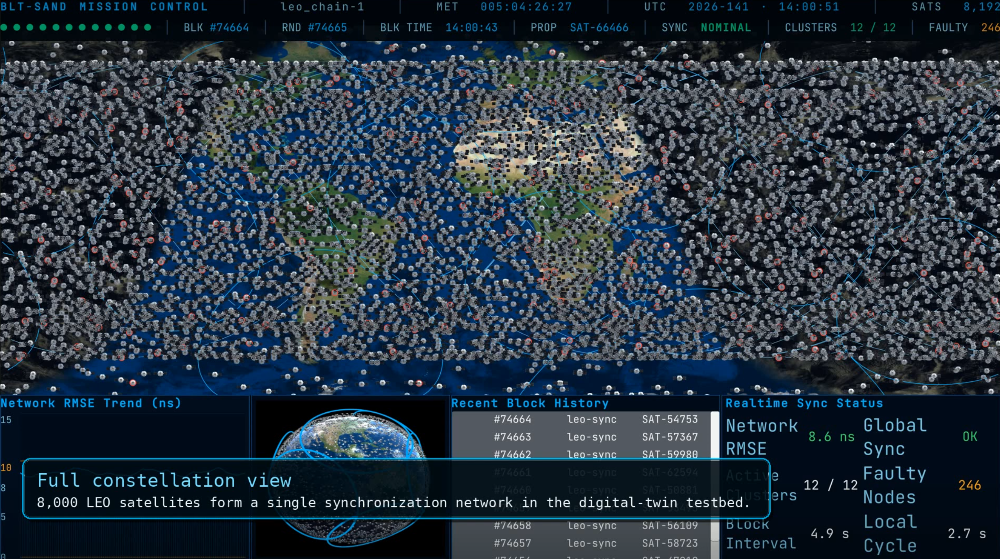

# BLT_dt, the digital twin

The Unity scene behind §IV-A: a 3D Earth with the real Starlink constellation propagated from TLEs,
the clusters and their heads drawn as they are re-formed, the ISL graph as the link model admits it,
and the live chain state polled from a running `leochaind`.

<div align="center">


*Mission control at N = 8,192: the constellation, the network RMSE, the active clusters and the
block height the chain is on.*
</div>

Everything on screen is computed or fetched. The orbits come from SGP4/SDP4 on real elements, the
links appear and break by the same geometry the simulator uses, and the synchronization state is
read from the chain over RPC. What it is for is seeing a configuration before committing a sweep to
it. Its ISL link model is held to the simulator's by `BLT_simul/tools/isl_parity.py`, so the
geometry it draws and the geometry the experiments run on are the same model, checked rather than
assumed.

## What is in it

```
Assets/
  Scripts/              orbital mechanics, the globe, the clusters, the chain client
  Scenes/SampleScene    the testbed scene
  Shaders/ Material/    globe, atmosphere, day/night terminator
  Prefabs/ Fonts/
  StreamingAssets/      STARLINK_TLE.txt goes here, not redistributed
  EarthRendering Free/  third-party globe asset, see its own README
```

| Script | What it does |
|---|---|
| `NoradSGP4.cs`, `NoradSDP4.cs`, `NoradBase.cs` | The SGP4/SDP4 propagators |
| `Tle.cs`, `Orbit.cs`, `Eci.cs`, `Julian.cs`, `Coord.cs`, `Site.cs` | Elements, orbital state, time and frame conversion |
| `Satellite.cs`, `EarthOrbit.cs` | One satellite, and the constellation's motion |
| `GlobeManager.cs`, `MapManager.cs`, `GlobeRotator.cs` | The globe, the map and the day/night terminator |
| `ClusterSelector.cs` | Which cluster the view is filtered to; arrow keys and the UI buttons |
| `IslLinkModel.cs`, `IslLinkManager.cs` | Distance-dependent ISL availability, and drawing the graph |
| `FaultySatelliteManager.cs` | Marks degraded satellites and places faults |
| `BlockchainPoller.cs` | Polls the chain's RPC for the committed epoch |
| `SimulationStateSource.cs` | Reads live state from the simulator's `rmse_server.py` |
| `MonitorPanel.cs`, `RmseGraphPanel.cs`, `MissionStatusBar.cs` | On-screen readouts |

## How it runs

Each frame the scene advances simulated time, propagates every satellite from its elements, and
redraws what follows from the new positions:

```
TLE elements  -> SGP4/SDP4 -> ECI -> scene position        Satellite.cs, Orbit.cs, Eci.cs
state server  -> cluster and head per NORAD id             MapManager.cs, GlobeManager.cs
positions     -> range and pointing -> the ISL graph       IslLinkModel.cs, IslLinkManager.cs
chain RPC     -> height, round, sync state                 BlockchainPoller.cs
engine HTTP   -> RMSE, clusters, fault set                 SimulationStateSource.cs
```

Nothing here is pre-rendered. The clusters are re-formed from the current positions rather than
replayed, so membership turns over on screen as it does in the simulation, and a link disappears
because the two satellites are now too far apart or the geometry is grazing, not on a timer.

The two feeds are independent and either can be absent. Without the chain the orbits, clusters and
links still run and the block readouts hold their last value; without the state server the RMSE
falls back to a placeholder wave and the clusters to fixed centres. The table below says which is
which, so nothing on screen is ambiguous about whether it is measured or stood in for.

## Where each number on screen comes from

Three sources feed the scene and they are independent: the chain, the engine's
state server, and Unity's own geometry. Any of them can be absent, and what
the panel shows then is listed in the last column, so nothing on screen is
ambiguous about whether it is measured or stood in for.

| On screen | Source | With that source absent |
|---|---|---|
| Orbits and positions | Unity, SGP4/SDP4 over the TLE file | Placeholder constellation |
| Clusters and the fault set | State server `/state`, matched by NORAD id | Twelve fixed centres, an arbitrary fault set |
| Network RMSE, and the curve | State server `/rmse` | `RmseGraphPanel.PlaceholderWave`, a wave near 8.8 ns |
| Block height, round, sync state | Chain RPC `/status` | The last value held |
| ISL links and reachability | Unity, the C# port of the link model | Computed from whatever geometry the scene has |

The chain and the state server are polled separately, so running one without
the other leaves the other's cells live.

The placeholders exist so the scene opens and reads sensibly with nothing
running behind it. They are not measurements, and the values in the paper come
from the simulator and the chain, never from here.

## Running it

Unity **2021.3.8f1** (`ProjectSettings/ProjectVersion.txt`). Open the project and load
`Assets/Scenes/SampleScene.unity`. Two things have to be supplied:

**The TLE file.** `Assets/StreamingAssets/STARLINK_TLE.txt` is not in this repository, Space-Track
elements are not ours to redistribute. [`../BLT_simul/data/README.md`](../BLT_simul/data/README.md)
says how to obtain the same file the simulator uses, and both components read the same format, which
is what lets them be compared.

**The chain, if you want live state.** `BlockchainPoller` expects a `leochaind` RPC endpoint; start
one with [`../BLT_bft_chain/scripts/start_local.sh`](../BLT_bft_chain/scripts) and check it with
`scripts/check_unity_rpc.sh`. Without it the scene still runs, the orbits, clusters and links do
not depend on the chain, and the block readouts hold their last value.

Optionally, live synchronization numbers come from the simulator:

```bash
python ../BLT_simul/tools/rmse_server.py        # SimulationStateSource polls this
```

The `EarthRendering Free` asset is third party and carries its own licence; the globe will not
render without it.

### In the scene

| | |
|---|---|
| Right / Left arrow | Step to the next / previous cluster |
| Escape | Back to the whole constellation |

Selecting a cluster isolates it and its head, which is the quickest way to see what a single
cluster's membership does over a few minutes. `BlockchainPoller` defaults to
`http://localhost:26657` and is editable on the component in the inspector, as is the engine
endpoint on `SimulationStateSource`. `MonitorPanel`, `RmseGraphPanel` and `MissionStatusBar` are
the readouts; `FaultySatelliteManager` marks degraded satellites and places faults.

## Agreeing with the simulator

`IslLinkModel.cs` here and `blt_isl.py` in the simulator implement the same link model, and they are
checked against each other rather than trusted to match:

```bash
python ../BLT_simul/tools/isl_parity.py
```

It compiles `IslLinkModel.cs` and compares its availability curve against the Python one over the
same geometry. That script is the only one in the repository that reaches outside its own component,
and this is why.
