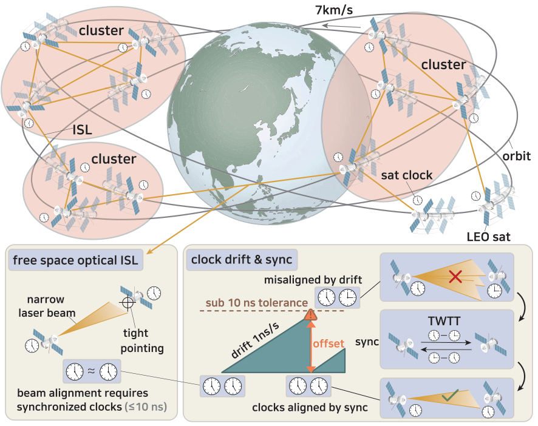
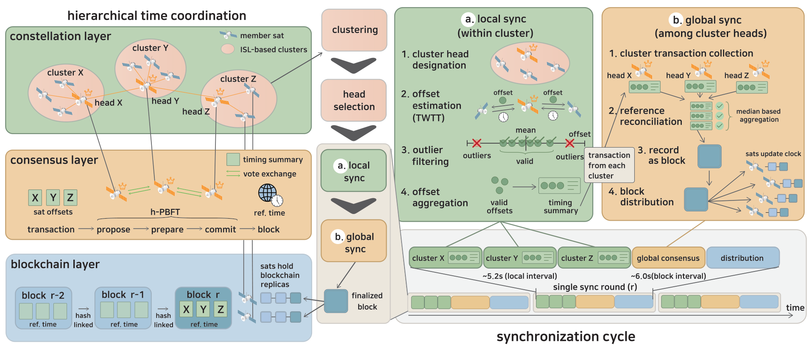
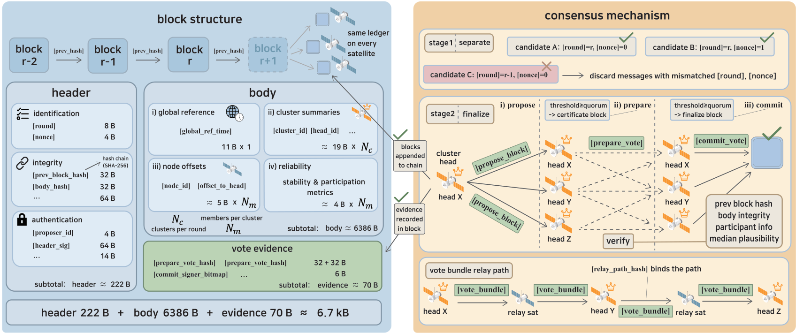
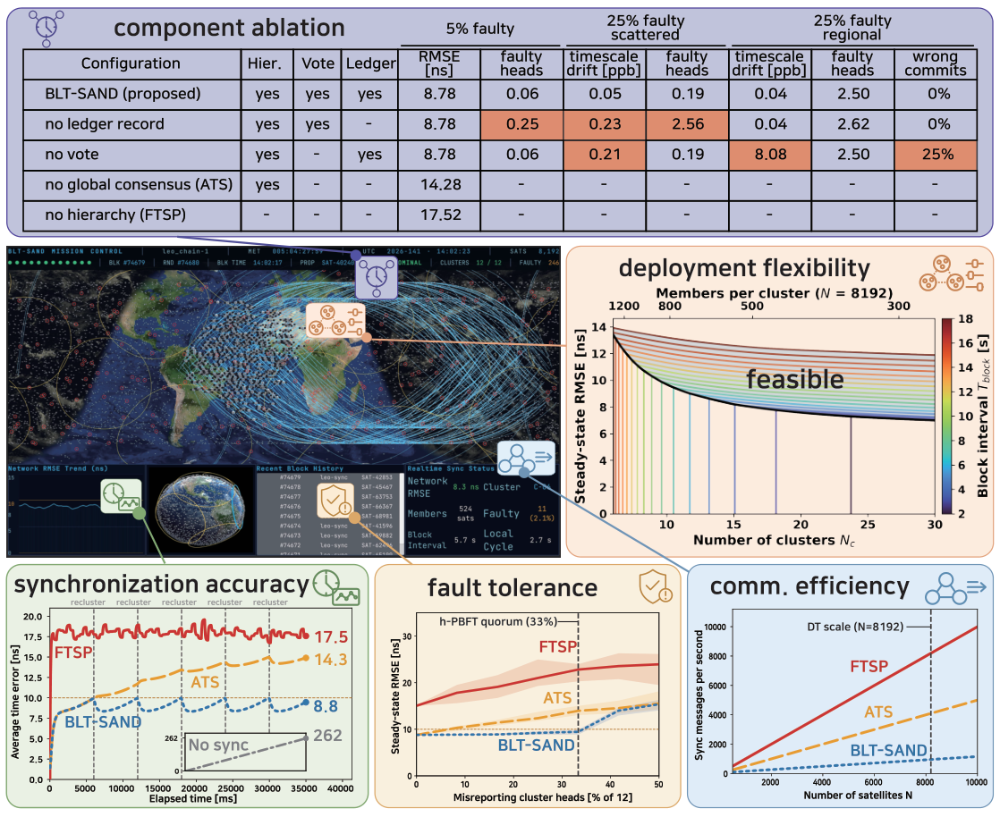

<div align="center">

# BLT-SAND

### Blockchain-Assisted Lightweight Time Synchronization for Satellite Network Decentralization

*A **lightweight blockchain**, with every satellite a node running hierarchical-PBFT (h-PBFT) consensus, holding a large-scale LEO constellation to **sub-10-ns** network time over inter-satellite links, without continuous reliance on GNSS or ground control.*

</div>

> **Paper.** Yong Hun Jang, Hong Ki Kim, Hee Soo Kim, Gun Kim, Dong Hak Shin, and Sang Hyun Lee,
> *"BLT-SAND: Blockchain-Assisted Lightweight Time Synchronization for Satellite Network Decentralization."*
>
> **Digital-twin demo:** [youtu.be/kGDHFrKU2DY](https://youtu.be/kGDHFrKU2DY)

<div align="center">


*8,192 LEO satellites on one synchronization network. Orbits propagated from Space-Track elements
and clusters re-formed as the constellation moves, with the block height read from a running chain
and the network RMSE and fault set from the engine's state server.*
</div>

This repository hosts the three artifacts behind the paper: the **simulation** that produces the
evaluation figures, the **consensus chain** that implements the hierarchical PBFT agreement, and the
**Unity digital twin** that flies the constellation and reads the live state of both.

Four documents carry the detail behind everything below:

- **[`docs/SIMULATION.md`](docs/SIMULATION.md)** is how the simulation works: the constellation, the
  clock and fault models, the two-way measurement, the local and global phases, the two schemes it
  is compared against, and the metrics.
- **[`docs/MODEL.md`](docs/MODEL.md)** holds the configuration, the accuracy metric, which assumptions
  the result is sensitive to, and what the model does not cover.
- **[`docs/REFERENCES.md`](docs/REFERENCES.md)** sets each assumption against the measurement or
  specification behind it, and the complete registry of values with their sources.
- **[`docs/FIGURES.md`](docs/FIGURES.md)** lists the evaluation panels, each with what it shows, the
  numbers to read off it, and the driver and CSV that regenerate it.

---

## 1. Overview

Free-space optical inter-satellite links (ISLs) require inter-satellite clock offsets to stay within
**about 10 ns** for reliable pointing, acquisition and tracking. GNSS-anchored synchronization
cannot guarantee this across a fast-moving LEO constellation: visibility is intermittent, ground
contact is sparse, and onboard oscillators drift independently between updates. An oscillator held
to 1 ppb gains or loses a nanosecond every second, so a 10 ns budget is spent in ten.

**BLT-SAND** maintains network time as a *shared, replicated state on an actual blockchain*. Every
satellite runs a blockchain node, keeps a local copy of the chain and commits one block per
synchronization round, rather than taking a value handed down from a central reference. Its
contributions:

1. **Hierarchical PBFT (h-PBFT).** Full-mesh PBFT costs O(n²) messages, which a constellation
   cannot carry. A two-tier design replaces it: satellites aggregate offsets *locally within
   clusters*, and only the **cluster heads** run *global* consensus. The voting set shrinks from
   every satellite to twelve, and the cost of a round lands inside what a spacecraft radio and
   processor can actually spend, which is the condition the scheme has to meet to be of any use.
2. **Consensus-validated time exchange.** Pairwise TWTT offset estimates are filtered locally
   (robust median/MAD) and confirmed by periodic global consensus, removing accumulated
   inter-cluster drift without any external or centralized anchor.
3. **Digital-twin validation.** A Unity testbed driven by real Space-Track orbital data and a
   CometBFT chain demonstrates sub-10-ns accuracy under realistic ISL and clock models.

<div align="center">


***Fig. 1.** Synchronization over an ISL-interconnected LEO constellation. A narrow optical beam
closes only while the two clocks agree to within about 10 ns, and an oscillator at 1 ppb drifts
that far in ten seconds.*
</div>

---

## 2. Architecture

### 2.1 Two-phase hierarchical synchronization

Synchronization alternates two complementary phases:

- **Local phase.** Members within the 2,500 km ISL range exchange timestamps with their cluster
  head by TWTT, over one to three relay hops. The head filters anomalous offset reports (robust
  median/MAD) and derives a cluster-level reference, suppressing short-term drift among nearby
  satellites.
- **Global phase.** Cluster heads reconcile their cluster-level references and run h-PBFT to commit
  a single block, removing accumulated inter-cluster discrepancies.

Cluster membership and heads are reselected as the topology evolves, which it does quickly: about
0.47% of the constellation changes cluster every 5 s, and half of it within ten minutes.

Reference design point: **8,192 satellites in 12 clusters of 683**, local cycle and global block
interval both **6 s**, block **6.7 kB**. The cycle is not a free choice. With two ISL terminals a head
needs 5.69 s to poll 683 members over an average 1.97 hops, which is what fits inside 6 s.

<div align="center">


***Fig. 2.** Decentralized synchronization procedure: the constellation, consensus and blockchain
layers, and one synchronization cycle. The cycle timeline shows a 5.2 s local interval
against a 6.0 s block interval; the configuration sets local = global = 6 s.*
</div>

### 2.2 Blockchain framework and consensus

Every satellite is a node holding a local copy of a hash chain that begins at a shared genesis block.
Each synchronization round appends exactly one block:

- **Header**, 222 B: round and nonce, previous-block hash, body hash, proposer identity and
  signature. The `(round, nonce)` pair disambiguates competing proposals caused by delayed or
  out-of-order delivery.
- **Body**, 6,386 B: the global reference time, one timing summary per cluster, and for each member
  of the cluster the offset it reported and the reliability indicators used for later outlier
  filtering and cluster-head selection.
- **Vote evidence**, 70 B: the prepare and commit vote hashes and the commit signer bitmap.

That totals 6,678 B, the 6.7 kB of Fig. 3. The body is a block's worth of one cluster, 8,192/12 =
683 members at 9 B each, and the
[chain readme](BLT_bft_chain/readme.md#what-the-blt-module-does) derives it field by field.

Consensus follows an h-PBFT **propose → prepare → commit** sequence over the active cluster heads at
the classical PBFT supermajority of **2/3**, which tolerates the Byzantine bound of **1/3** faulty
heads. Votes are relayed along an ISL path rather than broadcast, which is what keeps the message
count down. No single satellite unilaterally sets the network time, and a satellite that was
disconnected recovers it from the chain.

What the chain adds over a signed snapshot from one trusted head is that its admission rules cannot
be decided from the message alone. Each compares a proposal against something the network has
*already agreed on*: epoch order, monotonic reference time, the BFT block-time anchor, duplicate or
non-delegate heads, and cross-cluster plausibility. Those rules are in
`BLT_bft_chain/x/blt/keeper/` (`x/` is where a Cosmos SDK application keeps its own modules, and
`keeper` is the part of a module that may touch state), and §4.5 shows them rejecting five tamper
attempts on a real 12-validator testnet.

<div align="center">


***Fig. 3.** Block structure and consensus mechanism. The three subtotals are where the 6.7 kB block
comes from, and the relay path is why the vote does not cost a broadcast.*
</div>

---

## 3. Repository layout

Three components, one per artifact, plus the documentation that reads across them.

```
BLT_open/
├── BLT_simul/            Python   the simulator
│   ├── model/                the engine every script imports
│   ├── experiments/          one question per driver, grouped by the question
│   │   ├── accuracy/         what the schemes reach, and what each assumption is worth
│   │   ├── faults/           the three fault axes and how faults are placed
│   │   ├── ledger/           what consensus and the recorded history each contribute
│   │   ├── design/           cadence, cluster count, collection time, message rate
│   │   └── scale/            link model and constellation size
│   ├── figures/              fig_style.py and evaluation_panels.py, every panel in docs/FIGURES.md
│   ├── tools/                verification, Unity/Python ISL parity, the live state server
│   ├── data/                 TLE input, not redistributed, see BLT_simul/data/README.md
│   └── result/               outputs, written by the scripts; not tracked
├── BLT_bft_chain/        Go       the h-PBFT consensus chain (chain_id leo_chain-1, denom leo)
├── BLT_dt/               Unity    3D digital-twin testbed (globe, orbits, clusters, live chain state)
└── docs/                 SIMULATION.md, MODEL.md, REFERENCES.md, FIGURES.md,
                          REPRODUCING.md
    └── figures/              the evaluation panels, PNG and vector PDF
        └── paper/            Figs. 1-4 as the paper carries them
```

| Component | Maps to paper | What it is | Simulated or measured |
|---|---|---|---|
| [`BLT_simul/`](BLT_simul) | §IV Feasibility evaluation (Fig. 4) | The simulator: 8,192 clocks, the two-phase synchronization, ATS and FTSP to compare against, and the drivers that sweep them. | Simulated |
| [`BLT_bft_chain/`](BLT_bft_chain) | §III Consensus mechanism (Fig. 3) | The chain itself, on CometBFT v0.38.17. | **Measured** |
| [`BLT_dt/`](BLT_dt) | §IV-A Digital twin testbed | The Unity scene: real orbits, live clusters and links, live chain state. | Both, side by side |

**[`BLT_simul/`](BLT_simul) runs the protocol at constellation scale.** Eight thousand clocks, the
two-phase synchronization, and ATS and FTSP on the same engine so a difference between them is the
mechanism and not the setup. It is where every evaluation figure comes from.

**[`BLT_bft_chain/`](BLT_bft_chain) runs the consensus.** A Cosmos SDK application chain whose `blt`
module carries one message, a synchronization epoch holding the proposed reference time, the cluster
heads' reported offsets and the per-member precision records. It admits that message only if it
survives fourteen checks, and those checks are the design: a proposal from outside the delegate set,
a reference time that does not advance, the same head counted twice, a declared count that
disagrees with the block's own tables, a global time that contradicts most of the cluster summaries
it carries. Each is refused by code with its own error. What the ledger costs and what tampering
achieves are read off twelve validators running this chain. Its
[readme](BLT_bft_chain/readme.md) lists the error codes against the attacks that reach them.

**[`BLT_dt/`](BLT_dt) runs the constellation against real orbits.** It is where the other two meet
a geometry neither of them chose: SGP4/SDP4 propagates 8,192 Space-Track elements forward in time,
the clusters re-form from the positions that produces, and the ISL graph is built and broken by the
same distance-dependent model the simulator uses, in its own C# implementation. The two
implementations are held to agreement by `BLT_simul/tools/isl_parity.py`, which compiles the C# and
compares outage probability, link set, routable count, mean hops and path loss against the Python
over the same geometry. It polls a running `leochaind` for block height and consensus state, and
the state server for the synchronization error, so what it reports is what the chain and the engine
actually produced rather than a third model. That it also renders all of this is how you watch a
run; the orbits, the clusters and the links on screen are the computed ones.

## 4. Design assessment

The testbed is evaluated against two benchmarks: **ATS** (average time synchronization, mean
aggregation within clusters) and **FTSP** (flooding time synchronization protocol, a single
externally-anchored reference flooded hop by hop). The ISL requirement is **10 ns**. Captions,
numbers and the regeneration command for every panel are in
[`docs/FIGURES.md`](docs/FIGURES.md); the highlights follow.

<div align="center">


***Fig. 4.** Digital-twin testbed and design assessment, as the paper carries it.*
</div>

Every part of that figure is one of the sections below, rendered from the same CSVs by
`BLT_simul/figures/evaluation_panels.py`: the component ablation of §4.5 is the table across its
top, and §4.1-§4.4 are the four panels under it.
[`docs/figures/paper/README.md`](docs/figures/paper/README.md) maps them one to one. §4.6 and §4.7
then cover the two results the figure has no room for: what regionally correlated degradation does,
and what the hierarchy costs at constellation scale.

### 4.1 Synchronization accuracy

<div align="center">

</div>

Relative RMSE, the nominal satellites' clocks about the mean of those same clocks, over a 35 s
window, 8 seeds, with
satellites initialized at zero offset. Without synchronization, drift accumulates to **262 ns**.
After the initial transient every scheme shows an oscillatory RMSE, because synchronization events cut
accumulated error while drift rebuilds it before the next update. **FTSP settles on a 17.8 ns
staircase and ATS peaks near 15 ns (mean 14.5), both above the 10 ns line, while BLT-SAND oscillates
between 8.2 and 10.2 ns for a mean of 8.8 ns** and returns to its steady state within a few rounds of
each 6 s update. ATS stays sensitive to faulty offset reports because it aggregates by the mean, and
FTSP accumulates residual mismatch along its flooding path; BLT-SAND filters unreliable measurements
locally and periodically removes inter-cluster drift through global consensus.

What sets that 8.8 ns is how finely a satellite can timestamp an arriving pulse, which is the
subject of §4.8.

### 4.2 Fault tolerance

Degradation among ordinary members and degradation among the twelve heads are measured on
separate axes, because the scheme answers them with different machinery: a bad member is caught by
the local median filter, a bad head by the vote. The two axes show where each one runs out.

<div align="center">


</div>

Left, degradation scattered over all satellites, 0–40%: at these shares no cluster acquires a
degraded majority, so what is tested is the local filter alone, and **BLT-SAND stays flat at
8.81 ns** while ATS reaches 10.05 and FTSP 22.37. Right, the share of the twelve cluster heads, which
is what the PBFT bound is over: **up to a third of the heads BLT-SAND holds inside 10 ns (median
9.47) and stays below ATS at every point**, and past the bound it becomes indistinguishable from it.
The grey dashed line is what the quorum costs: the commit rate falls to 62% at a third of the
heads. That is the trade the vote makes: a round that does not reach quorum writes nothing to the
ledger, so no wrong value becomes the network's time. In the arm this panel uses the heads still
reconcile toward the median of what they heard, which keeps the clocks moving without recording
anything, and that is why accuracy holds while the commit rate falls. What the vote spends is
availability, which suits a pointing budget that fails hard.

### 4.3 Communication efficiency

<div align="center">

</div>

Each scheme runs at the longest cycle that still meets 10 ns, so the comparison reflects inherent
communication demand. Those cycles are measured, not assumed: **BLT-SAND 9 s, ATS 2 s, and FTSP has
no cycle that reaches 10 ns at all.** At the testbed scale of N = 8,192 that is **960 messages/s for
BLT-SAND against 4,100 for ATS**, a factor of 4.3. ATS has to shorten its interval to compensate
for growing timing error, which raises overhead; BLT-SAND removes unreliable measurements during
consensus and meets the same target with a longer interval and a quarter of the messages.

FTSP is a different case. A shorter flood does cut the drift it accrues between floods, but only
onto a floor it cannot go below: the one-way timestamp budget accumulated along the flood path,
which the cycle does not touch and which measures **17.3 to 18.5 ns from a 0.1 s cycle out to 6 s**.
It is drawn at 1 s, already slower and so cheaper than the 0.45 s this work runs FTSP at elsewhere,
and the longest measured cycle that still refreshes more often than either scheme it is compared
with. Even there it sends **8,200 messages/s** and does not reach the target.

### 4.4 Deployment flexibility

<div align="center">

</div>

The x axis is the number of clusters `N_c` and the y axis the steady-state RMSE. Each curve is one
block interval `T_block`, coloured by the bar on the right, with the local cycle set equal to it.
The upper x axis restates `N_c` as members per cluster, since `N` = 8,192 is fixed: small `N_c`
means large clusters.

Two pressures work against each other along that axis. Small `N_c` puts more satellites under each
head, which aggregates better, but the head has more members to poll, so `T_block` has to be long
enough to collect them. Large `T_block` leaves more collection time but lets the clocks drift further
between rounds.

**The shaded `feasible` area is where both are satisfied at once:** a head finishes polling its
cluster within `T_block`, so the round closes on schedule. Each curve starts at the smallest `N_c` its
collection time permits at that `T_block`, and the thick line joining those starting points is the
boundary.

The reference design, `N_c` = 12 at `T_block` = 6 s, sits inside that area rather than on its edge, and
that is what the panel is for. An operator who wants shorter rounds, or who flies a different `N`,
moves to another point inside it and the scheme still runs. The configuration used throughout this
repository is one choice from a region, not the only one that works.

### 4.5 What the blockchain adds

The fifth element of the revised Fig. 4, carried as a table above the four panels. One component is
removed at a time, under three fault conditions ordered by how much the faults concentrate:

<div align="center">

</div>

The proposed design is best in every cell. **Remove the vote** and, under regionally correlated
degradation, the constellation's common time drifts at **8.08 ppb instead of 0.04** while 25% of
rounds commit a wrong value. **Remove the ledger** and, under scattered degradation, the degraded
heads per round go from **0.19 to 2.56**. Notably the relative RMSE is 8.8 ns for all three BLT-SAND
rows: a wrong commit shifts every cluster by the same amount, so the satellites stay aligned with one
another and the damage appears in the common timescale, not in the inter-satellite metric.

The ledger's own contribution is choosing who reports. Selecting each head by its recorded precision
takes the degraded heads per round from **3.33 to 0.13** at a 25% degraded share, and the record has
to be the *whole* history rather than the latest round: under intermittent degradation, full history
gives 0.75 degraded heads where the newest round alone gives 2.02 and no record 2.44. It also has to
be constellation-wide, because membership turns over. Half the constellation changes cluster within
ten minutes, so a per-cluster record is held by something that does not last.

And the rules are measured on the real chain, not asserted. Five tamper attempts, rewinding the
epoch, replaying a captured transaction, forging the reference time, a duplicate head, a proposal
from a non-delegate, are all rejected, the ledger is unchanged, and all twelve nodes reach the same
verdict:

<div align="center">

</div>

A history also behaves differently from a snapshot when a node has been away. Disconnect one, let
the swarm keep committing, and let it rejoin: recovery takes 5 to 6 s whether it missed one epoch or
ten, about one block interval, and only the volume received grows with the gap (106 kB after one,
257 kB after ten). What does scale is what comes back. Replaying the chain after ten missed epochs
returns 2,980 precision records, where a node handed only the current state gets the 298 in the
latest block however long it was gone. **Those records are what head selection runs on**, so the
returning node can be trusted with a head role immediately instead of having to earn a reputation
again.

### 4.6 Correlated faults, and why there is a quorum

<div align="center">

</div>

The faults in this model are benign: a degraded satellite stays up, follows the protocol and
reports what it believes. The case for a quorum does not rest on anyone lying. It rests on
degradation being **regional**: satellites crossing the same part of the orbit take the same dose at
the same time, so they err together and in the same direction.

Left, what that does to the fault distribution. Where the degradation sits matters more than how
much of it there is: **scattered, no cluster passes 43.5% however high the overall share goes;
concentrated, one cluster is already 100% degraded at an overall 10%.** That cluster's head has no
healthy satellite to choose from, so it reports a wrong value however the head is chosen, and that is the one
case the ledger cannot help with.

Right, the consequence for the time the network agrees on, with the vote (solid) and with the same
hierarchy and the vote removed (dashed). **With the vote the adopted value stays at 0.41-0.79 ns
whatever the placement or share, and no round commits a wrong value.** Without it the concentrated
placements run from 1.4 to 96 ns. Several heads agreeing on a wrong value looks to a vote exactly
like collusion, which is why a scheme that merely averages its heads cannot tell the difference and
a quorum can.

What BLT-SAND pays for this is availability, not accuracy: at a 40% degraded share the commit rate
is 96% scattered and 35% concentrated. A round that does not commit writes nothing to the ledger
rather than recording something wrong; in the arm these panels use the heads still reconcile toward
the median of what they heard, so the clocks keep moving while nothing is recorded.

### 4.7 Lightweight at scale

Four measurements on the real chain, which together are the "lightweight" claim.

<div align="center">


</div>

**It does not get slower with more validators.** Measured at N = 4, 8, 12 and 16: block size grows
only by the commit signatures, at **106 B per validator**, with the rest of the block flat; commit
latency is **flat at a 3.0 s mean with no trend in N**, while CPU per block per node grows roughly
linearly, 0.41 to 0.62 s. The spread within one run exceeds the difference between runs, which is
why no trend is drawn through the latency.

<div align="center">


</div>

**And only the heads vote.** Left, what the two-tier design avoids: **200 kB of traffic per validator
per block with twelve cluster heads, against roughly 65.5 GB if every satellite voted.** The all-satellite
bar is extrapolated from the measured chain using the per-validator signature cost above and a
quadratic traffic fit; that quadratic comes from a full-mesh localnet where every validator gossips
to every other, so it is an upper bound rather than a prediction. Right, five-year storage against
the 128 GB onboard budget: a **6.7 kB summary block grows to 176 GB over the mission**, which one hard
fork absorbs, whereas carrying the full per-member record would make it 3.6 TB.

### 4.8 How much the measurement itself matters

The third fault category leaves the oscillators alone and corrupts the *measurement*. It matters
because every number above rests on how well a satellite can timestamp an arriving pulse, which is
hardware the designer chooses rather than physics they are given.

<div align="center">

</div>

Sweeping the per-timestamp jitter from 2 to 4 ns moves all three schemes together, and the ordering
never changes: the hierarchy's advantage is not an artifact of one jitter value. What the sweep does
set is the absolute number. At the 3 ns of a 100 MHz counter all three land on their reported
values, so **the 8.8 ns is that counter's figure, and a finer timestamping front end would lower it
for every scheme at once.**

Corrupting the exchanges instead of the clock gives the same ordering. With 5% of exchanges
returning an offset wrong by 50 ns, BLT-SAND reaches 14.22 ns against ATS 17.89 and FTSP 32.29; a
persistent 20 ns bias on 5% of satellites costs much less, 9.74 against 14.52 and 20.79. FTSP
degrades fastest because a bad hop is copied to everything behind it along the flooding path.

One limit is worth stating plainly: in the clustered schemes a bad measurement stays with the member
that made it. The median filter protects the cluster's reference, not that member's own correction,
so a satellite with a broken receiver is carried by the cluster rather than fixed by it.

## 5. Running the system

### 5.1 The chain

`BLT_bft_chain` is a Cosmos SDK application on CometBFT, chain id `leo_chain-1`. `leochaind` is an
ordinary node binary: `scripts/chain_scale.sh` brings up twelve validators on one machine, runs
synchronization epochs through them and writes the traffic, block size and timing that §4.3 and
§4.5 report. The `blt` module is the whole of the protocol-specific part, and the one message it
takes is the synchronization epoch described in §2.2. Admission, the fourteen checks and the error
each failure returns are in its [readme](BLT_bft_chain/readme.md); the block layout and what it
costs on the wire are in its [spec](BLT_bft_chain/docs/spec/BLT-SAND-chain-spec.md).

A node that is only reading does not need to validate: the state the digital twin draws is fetched
from any node over RPC, which is how the two components below connect.

### 5.2 The digital twin

`BLT_dt` is a Unity 2021.3.8f1 testbed that renders the constellation from **Space-Track** TLEs,
with Earth rotation, day and night, orbits, clusters and degraded-satellite highlighting, and shows
the live state of the system.

**It computes the geometry and fetches everything else.** From the TLEs it propagates positions and
derives the ISL link set and the routing to each cluster head (`Assets/Scripts/IslLinkModel.cs`,
`IslLinkManager.cs`). That C# port is checked against `BLT_simul/model/blt_isl.py` by `BLT_simul/tools/isl_parity.py`,
which compares outage probabilities, link sets, routable counts, mean hops and expected path loss at
N = 500 and N = 8,192. Everything else comes from outside:

- **blocks** from the chain over Tendermint RPC (`BlockchainPoller.cs`), for block height and
  consensus state;
- **synchronization state** from `BLT_simul/tools/rmse_server.py` through `SimulationStateSource.cs`: the
  RMSE, and which satellite is in which cluster and which is degraded, keyed by NORAD catalog
  number, so the screen shows what the engine actually ran rather than a second model written in C#.

With no server running, each panel falls back to what it did before (a placeholder wave, twelve fixed
cluster centres, a shuffled fault set) and says so.

The FSO ISL model uses 2.5 W transmit power, 1,550 nm wavelength and 20 µrad beam divergence.
Demo video: [youtu.be/kGDHFrKU2DY](https://youtu.be/kGDHFrKU2DY).

> Credentials (Space-Track) and the chain RPC endpoint are **not** bundled; supply your own. See
> [`BLT_simul/data/README.md`](BLT_simul/data/README.md); the RPC endpoint defaults to `http://localhost:26657` and the
> state server to `http://127.0.0.1:8000`. The Earth-rendering asset package is not redistributable
> either; see `BLT_dt/Assets/EarthRendering Free/README.md`.

---

## 6. Reproducing the evaluation

```bash
pip install numpy scipy scikit-learn pandas geopy skyfield matplotlib requests

python BLT_simul/experiments/accuracy/timeseries.py        # a driver writes a CSV
python BLT_simul/figures/evaluation_panels.py              # the figures read it
N=12 K=3 TAMPER=1 RECOVERY=1 CROSS=1 \
    bash BLT_bft_chain/scripts/chain_scale.sh              # the chain measurements
```

Every number below comes from one of about twenty drivers, each answering one question and writing
one CSV, or from a chain log.
**[`docs/REPRODUCING.md`](docs/REPRODUCING.md)** lists each driver against the question it answers
and the file it writes, the four parts of the chain run, and the three checks to run after changing
the engine. The constellation needs a TLE file that is not ours to redistribute
([`BLT_simul/data/README.md`](BLT_simul/data/README.md)).

---

## 7. Glossary

| Term | Meaning |
|---|---|
| **ISL** | Inter-satellite link (here, free-space optical) |
| **TWTT** | Two-way time transfer: pairwise timestamp exchange for clock-offset estimation |
| **h-PBFT** | Hierarchical Practical Byzantine Fault Tolerance: the two-tier consensus of BLT-SAND |
| **Cluster head** | Satellite that aggregates its cluster's offsets and participates in global consensus |
| **ATS / FTSP** | Benchmark protocols (mean aggregation / single-source flooding) |
| **OCXO** | Oven-controlled crystal oscillator (the onboard clock model) |
| **RMSE** | Relative RMSE: the nominal satellites' clocks about the mean of those same clocks |
| **ppb** | Parts per billion of frequency offset; 1 ppb is 1 ns of drift per second |

---

## 8. Citation

```bibtex
@article{jang2026bltsand,
  title   = {BLT-SAND: Blockchain-Assisted Lightweight Time Synchronization
             for Satellite Network Decentralization},
  author  = {Jang, Yong Hun and Kim, Hong Ki and Kim, Hee Soo and
             Kim, Gun and Shin, Dong Hak and Lee, Sang Hyun},
  year    = {2026},
  note    = {Update with final venue details.}
}
```

Questions: please open an issue.
