# Evaluation figures

Every panel here is rendered by `BLT_simul/figures/evaluation_panels.py` from a CSV or a chain log
that a driver in `BLT_simul/experiments/` or `BLT_bft_chain/scripts/` produced; where an input is
missing the script skips that panel. Each figure is in this folder as a PNG and as a vector PDF,
and the script writes exactly these twenty, in this order.

The paper's own figures are in [`docs/figures/paper/`](figures/paper/). Figs. 1-3 are concept
diagrams that no script produces; Fig. 4 is the design assessment, and each part of it is one of
the panels below.

Unless a caption says otherwise the configuration is the adopted one ([`MODEL.md`](MODEL.md)):
N = 8,192 satellites in 12 clusters, local = global cycle 6 s, healthy oscillator 1 ppb, degraded
27.5 ppb spread + 19 ppb bias, 100 MHz counter with 3 ns jitter, ISL link model on. The accuracy
metric is the relative RMSE: the **nominal** satellites' clocks about the mean of those same
clocks;
[`MODEL.md`](MODEL.md) defines the configuration and the metric and says where each number in
them comes from. Sizes are SI (1 kB = 1000 B).

**Contents**

| | |
|---|---|
| [1. Accuracy](#1-accuracy) | What the schemes reach, and what sets it |
| [2. The fault axes](#2-the-fault-axes) | Degraded members, degraded heads |
| [3. What the ledger and the vote contribute](#3-what-the-ledger-and-the-vote-contribute) | One component removed at a time |
| [4. Correlated faults and cross-cluster checks](#4-correlated-faults-and-cross-cluster-checks) | Why placement decides everything |
| [5. The chain, measured](#5-the-chain-measured) | Recovery, tampering, scaling, cost |
| [6. Links, geometry and deployment](#6-links-geometry-and-deployment) | The ISL model, the cadence, the cost of scale |

---

## 1. Accuracy

### 1.1 Synchronization accuracy over time

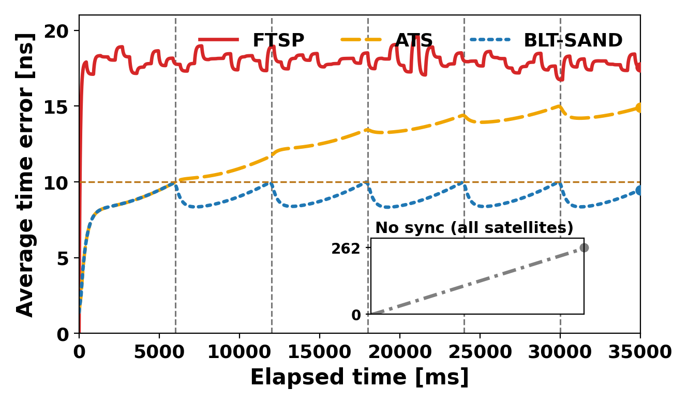

The three schemes and no synchronization over a 35 s window, 8 seeds, drawn by the paper's Fig. 4(a)
code and its EMA smoothing. Each scheme settles into a sawtooth: a synchronization event cuts the
accumulated error, drift rebuilds it before the next one. **BLT-SAND oscillates between 8.2 and
10.2 ns, mean 8.8 ns.** ATS peaks near 15 ns (mean 14.5) and FTSP sits on a 17.8 ns staircase, both
above the 10 ns ISL requirement. The inset carries no synchronization on a 0–300 ns scale to its
262 ns end state.

Smoothing is display-side only, every curve is plotted at its true amplitude.

`BLT_simul/experiments/accuracy/timeseries.py` → `BLT_simul/result/runs/timeseries.csv`,
drawn by `BLT_simul/figures/evaluation_panels.py`

---

### 1.2 Sensitivity to timestamp jitter

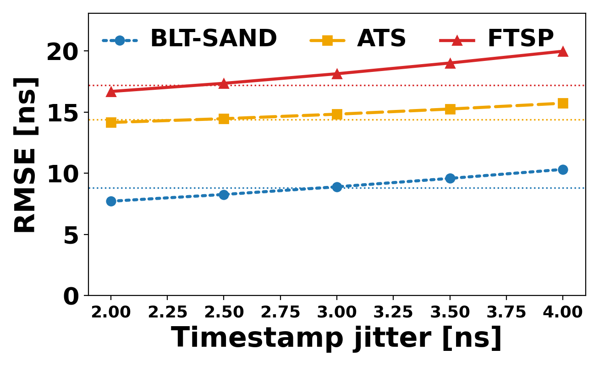

Timestamp jitter swept 2–4 ns with everything else held fixed. All three schemes rise monotonically:
**BLT-SAND 7.7 → 10.3 ns, ATS 14.2 → 15.7, FTSP 16.7 → 20.0**, and the three cross their reported
values together at 3 ns (dotted lines). The headline is therefore a property of the timestamping
assumption rather than of the synchronization design: a counter twice as noisy moves every scheme, in the same
direction, by a similar factor.

`BLT_simul/experiments/accuracy/sensitivity_sweep.py` → `BLT_simul/result/fit/jitter_sweep.csv`

---

## 2. The fault axes

### 2.1 Member faults

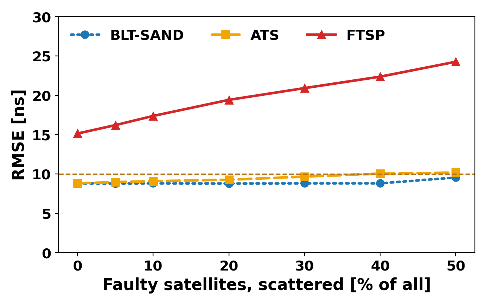

Degraded oscillators scattered uniformly over all 8,192 satellites, 0–40%, 8 seeds. At these shares
no cluster acquires a degraded majority, so every head still reports honestly and what is tested is
the local median + MAD filter alone. **BLT-SAND stays flat at 8.81 ns across the whole range**; ATS
reaches 10.05 and FTSP 22.37.

`BLT_simul/experiments/faults/fault_axes.py --axis member` → `BLT_simul/result/runs/fault_axes_member.csv`

---

### 2.2 Cluster-head faults

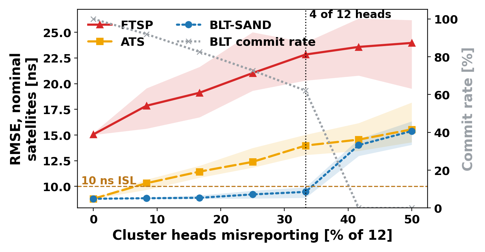

The share is of the twelve cluster heads, which is what the PBFT bound is actually over, and the
failed-round fallback is on, a round that misses the quorum reconciles
toward the median of the reports it heard, which is what the same hierarchy would do with no
consensus at all. That keeps the arms comparable past the bound, instead of comparing a scheme that
has stopped against schemes that have not. **Up to a third of the heads BLT-SAND holds inside 10 ns
(median 9.47) and stays below ATS at every point**; past the bound it becomes indistinguishable from
it. The band is the interquartile range over seeds × cluster combinations; the grey dashed line is
the commit rate on the right axis, which is what the quorum costs, down to 62% at a third.

`BLT_simul/experiments/faults/fault_axes.py --axis head` → `BLT_simul/result/runs/fault_axes_head*.csv`

---

## 3. What the ledger and the vote contribute

### 3.1 The ablation, as one table

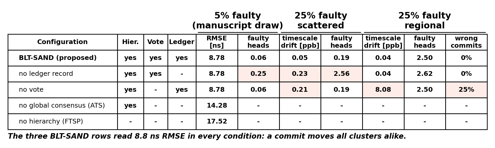

Rows are the proposed design and the same design with one component removed; the flags say what each
row still has. Columns are grouped by fault condition, in order of how much the faults concentrate
(5% scattered → 25% scattered → 25% regional), and each condition carries only the metrics its fault
actually moves. **The proposed design is best in every cell**, and a cell is shaded where a removal
costs more than a factor of two:

- **remove the vote**, under regional faults the common time drifts at **8.08 ppb instead of 0.04**,
  and 25% of rounds commit a wrong value.
- **remove the ledger**, under scattered faults the degraded heads per round go **0.19 → 2.56**.

Relative RMSE is 8.8 ns for all three BLT-SAND rows in every condition, because a wrong commit moves
every cluster by the same amount and the satellites stay aligned with one another. **The headline
metric cannot see what the vote is for.** That is why the table reports the common timescale and the
degraded-head count beside it: the damage is real and it lands somewhere the RMSE does not look.

`BLT_simul/experiments/ledger/ablation_ladder.py` → `BLT_simul/result/runs/ablation_ladder.csv`

---

### 3.2 Choosing heads from the recorded precision

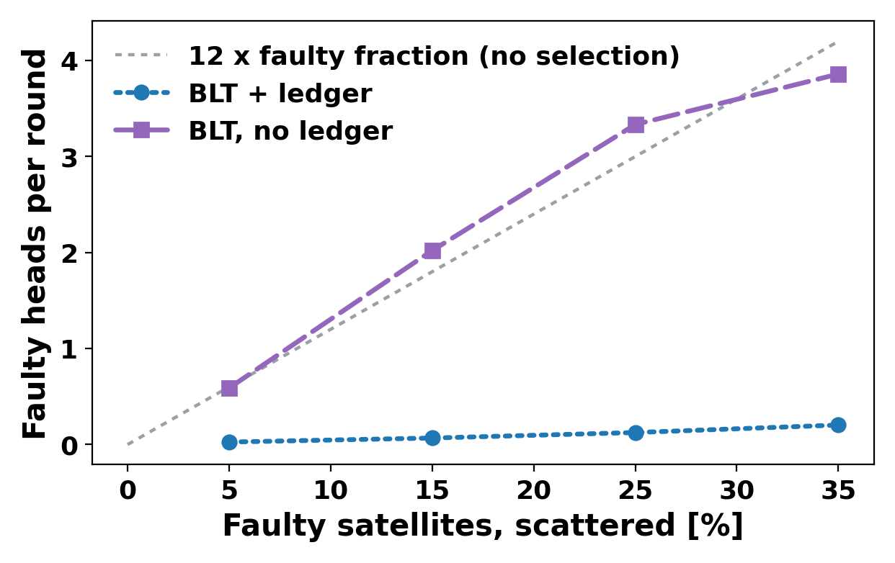
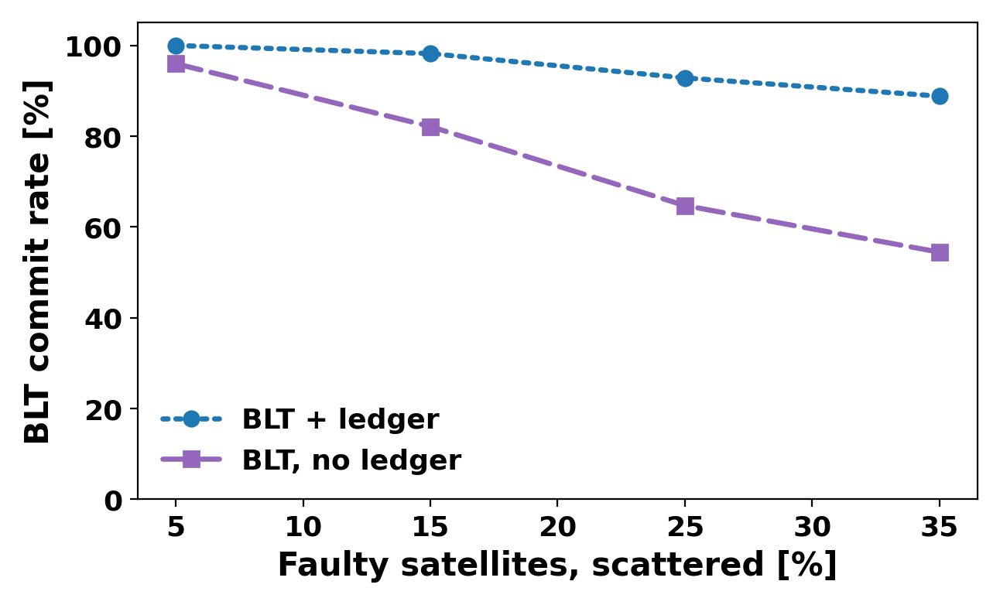

The head of each cluster is the member with the best recorded precision among the candidates nearest
the centroid. With degradation scattered at random, **the degraded heads per round fall from 3.33 to
0.13 at a 25% share** (left). The grey baseline is the expectation with no selection at all, 12 × the
degraded share, and the no-ledger curve sits on it. The commit rate (right) rises from 65% to 93%,
monotonically; what remains of the loss is the first round of each run, where no satellite has a
record yet and the heads are chosen blind.

`BLT_simul/experiments/ledger/ledger_history.py` → `BLT_simul/result/runs/ledger_history.csv`

---

### 3.3 Why the *whole* history, not the latest round

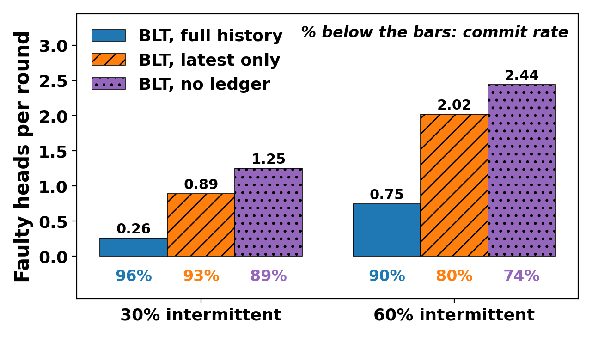

A satellite crossing a radiation belt degrades, recovers when it leaves, and degrades again next
pass, so its newest measurement can look healthy while its record does not. With degradation drawn
independently each round (p = 1/3, 64 seeds), at a 60% share the degraded heads per round are
**0.75 with the full history, 2.02 with the latest round only, and 2.44 with no record**, matching
the analytic 2.00 and 2.40 for the latter two. Keeping only the newest round helps almost nothing;
keeping the history cuts the degraded heads to a third. The percentages under the bars are commit
rates.

`BLT_simul/experiments/faults/intermittent_faults.py` → `BLT_simul/result/runs/intermittent_faults.csv`

---

### 3.4 How fast cluster membership turns over

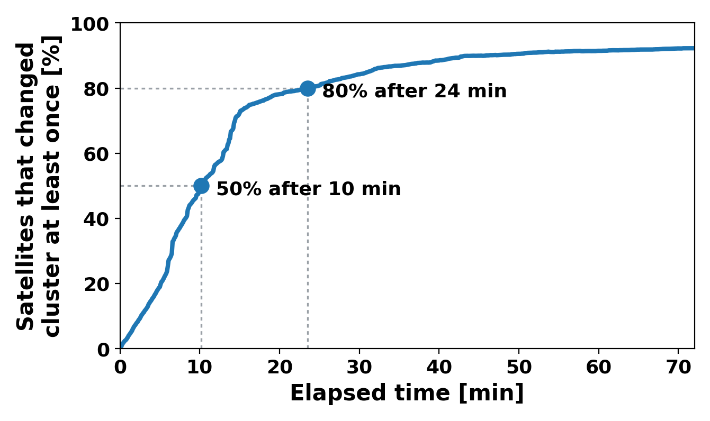

Positions propagated and re-clustered with no synchronization running, 20 minutes.

| Elapsed | Changed cluster in this 5 s update | Changed at least once |
|---|---:|---:|
| 2 min | 34 (0.42%) | 7.6% |
| 10 min | 69 (0.84%) | **48.7%** |
| 24 min | 12 (0.15%) | **80.2%** |

Averaging **0.47% per 5 s**: half the constellation has been re-assigned within ten minutes and 80%
within twenty-four. This is the dynamics any per-cluster state has to survive, and the reason the precision record
is held in the committed ledger rather than by the cluster that measured it.

`BLT_simul/experiments/ledger/cluster_migration.py --turnover-only` → `BLT_simul/result/runs/cluster_migration_turnover.csv`

---

## 4. Correlated faults and cross-cluster checks

### 4.1 Where the faults sit, and what that does to the agreed time

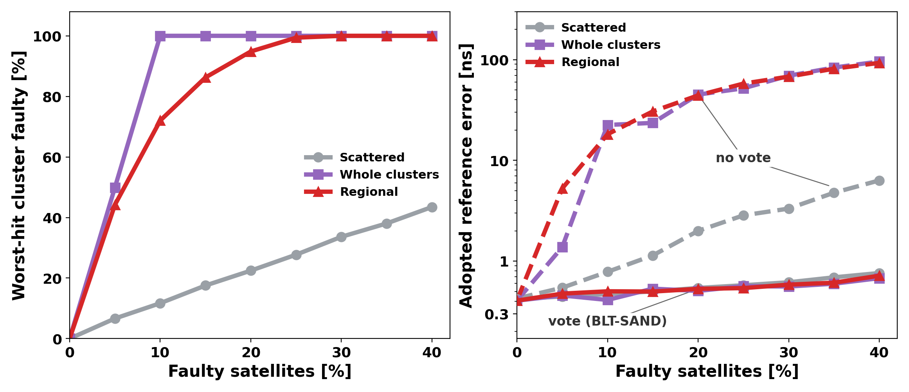

The left-hand panel is the fault model. The faulty share of the *most contaminated* cluster, against the share over the whole constellation.
Where the degradation sits decides everything: **scattered, no cluster passes 43.5% however high the
overall share goes; concentrated, one cluster is already 100% degraded at an overall 10%.** That
cluster's head has no healthy satellite to choose from, so it reports a wrong value however the head
is selected, exactly the case the ledger cannot help with and the vote must.

The right-hand panel is the consequence, on the same axis and in the same colours: how far the reference value the network
adopted sits from what its non-lying clusters reported for themselves. Solid is with the vote,
dashed is the same hierarchy with the vote removed and nothing else changed. Only committed rounds
are counted, because the axis is the time the network agreed on and a refused round agreed on
nothing.

**With the vote the adopted value stays at 0.41–0.79 ns regardless of placement or share, and not one
round commits a wrong value.** Without it, the concentrated placements run from 1.4 to 96 ns. The
0.4 ns floor is the sampling error of a median over 683 satellites, not a synchronization error.

The slow rise of the scattered no-vote curve, 0.5 → 6.3 ns, has a closed form: about 1% of degraded
oscillators draw a realized drift near zero and are indistinguishable from healthy ones in a record
*of precision*, so wrong heads grow in proportion to the fault share (0.02 → 0.34 of twelve), a wrong
head only matters on its turn as proposer, and one such event is a constant 165 ns, about
**0.15 ns per 1% of degraded satellites**. This is not the ledger failing: without it the wrong heads
would be 12 × the share. The ledger judges *reputation*; the vote judges the *value*.

The two scattered curves are smoothed over three adjacent points in log space, because they are the
rate of a rare event and scatter point to point; the concentrated curves are raw, since smoothing
them halves a real jump.

`BLT_simul/experiments/faults/correlated_faults.py`, `BLT_simul/experiments/faults/fault_concentration.py` →
`BLT_simul/result/runs/correlated_faults_runs_sweep.csv`, `fault_concentration.csv`

---

### 4.2 The same checks on the real chain

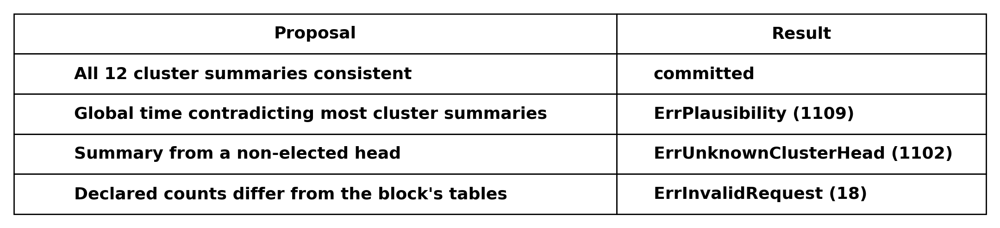

An honest block carrying all twelve cluster summaries commits. A block whose global reference
contradicts most of the cluster summaries it carries, a summary from a head that was never elected,
and a declared record count that disagrees with the table inside the block are all rejected, and
**all twelve nodes reach the same verdict on every case**, which is the part that distinguishes a
chain from one node's opinion.

---

## 5. The chain, measured

### 5.1 Recovery after a disconnection

One node is disconnected, the swarm keeps committing, and the node rejoins.

| Epochs missed | Blocks missed | Recovery time | Received | Records recovered: full history / latest block only |
|---:|---:|---:|---:|---|
| 1 | 3 | 6.2 s | 106 kB | 298 / 298 |
| 5 | 11 | 4.8 s | 135 kB | **1,490 / 298** |
| 10 | 21 | 6.2 s | 257 kB | **2,980 / 298** |

**Recovery takes 5–6 s regardless of how long the node was away**, one or two block intervals, and
only the volume received grows with the gap. The difference between the two right-hand columns is
the argument for a history rather than a snapshot: a node that receives only the latest state gets
the 298 records in the last block however much it missed, while a node that replays the chain
recovers everything accumulated while it was gone.

---

### 5.2 Tamper attempts

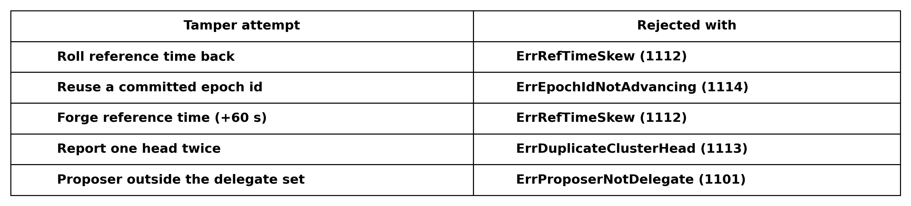

Five attempts, rewinding the epoch, replaying a captured transaction, forging the reference time by
60 s, reporting one head twice, and a proposal from outside the delegate set, each rejected with the
specific rule that caught it (`ErrEpochIdNotAdvancing`, `ErrRefTimeSkew`, `ErrDuplicateClusterHead`,
`ErrProposerNotDelegate`). The ledger is unchanged in every case, and the grid shows all twelve nodes
reaching the same verdict.

Each of these rules needs the committed history to decide. That is the concrete answer to what the
chain adds over a signed snapshot: a snapshot can be checked for internal consistency, but none of
these five can be caught from the message alone.

`BLT_bft_chain/scripts/chain_scale.sh` Parts B and C → `BLT_simul/result/chain/chain_n12_full.log`

---

### 5.3 Scaling the validator set

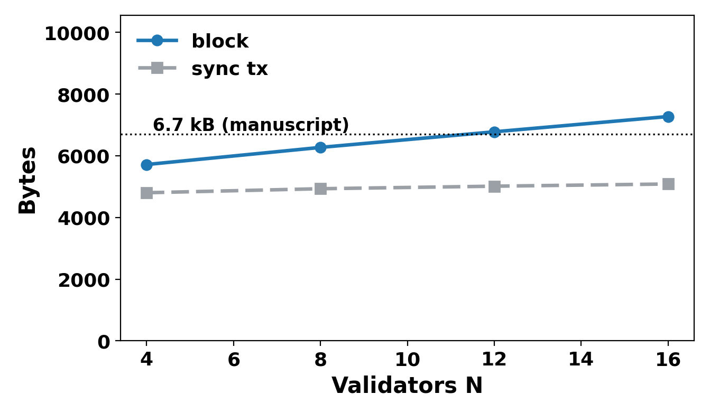
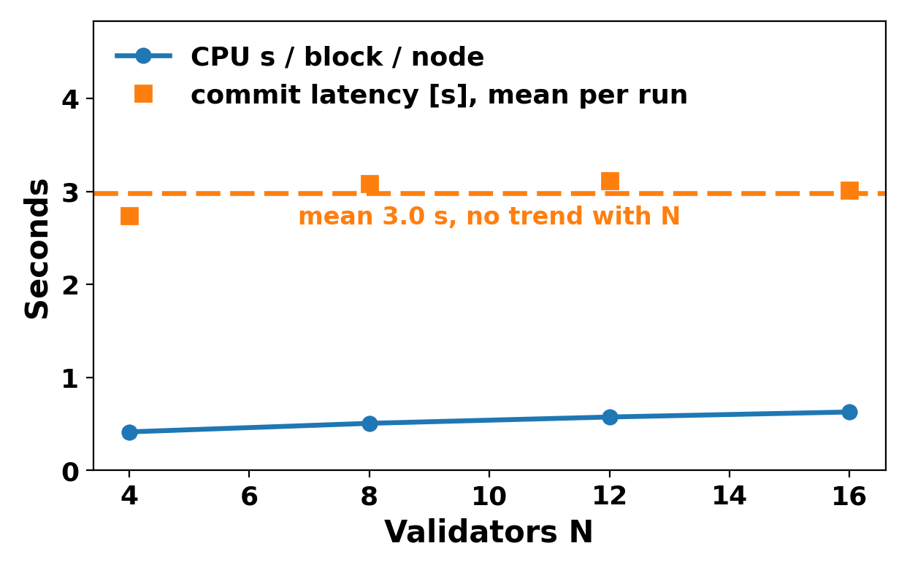

Measured at N = 4, 8, 12, 16 validators. Left, block size: the growth is the commit signatures, at
**106 B per validator**, with the rest of the block flat, which is what makes the extrapolation in
§5.4 a straight line rather than a guess. Right, **commit latency is flat at a 3.0 s mean with no
trend in N**, while CPU per block per node grows roughly linearly, 0.41 → 0.62 s. Points are per-run
epoch means; the spread within a run exceeds the difference between runs, which is why no trend line
is drawn through the latency.

---

### 5.4 Who votes: twelve heads, or all 8,192 satellites

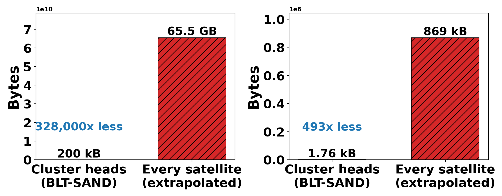

The cost of the hierarchy, stated as what it avoids. Left, **traffic per validator per block: 200 kB
with twelve cluster heads against about 65.5 GB if every satellite voted.** Right, **signature data per
block: 1.76 kB against 869 kB.** The all-satellite bars are extrapolations from the measured chain,
not measurements: the signature fit is the 106 B per validator of §5.3, and the traffic fit is the
quadratic in N that the same four chain runs give. Extrapolating 16 → 8,192 validators is a 512× reach, and the traffic figure is
99.9% quadratic term, so it is only as good as that form. That quadratic is an artefact of a
full-mesh localnet, where every validator gossips to every other; a deployed chain would not be
wired that way, so the all-satellite bars are an upper bound and not a prediction.

---

### 5.5 What goes in a block, against the onboard budget

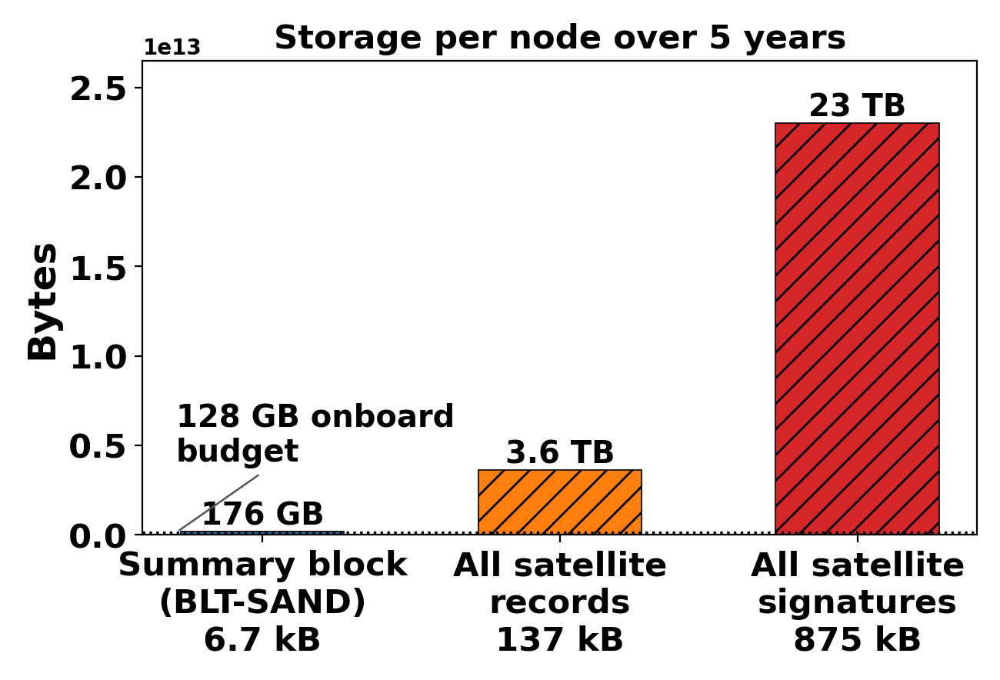

Five-year storage per node in units of the 128 GB onboard budget, where 1.0 is where a hard fork
becomes necessary. **A summary block of 6.7 kB grows to 176 GB over the mission**, which one hard fork
handles. Carrying the full per-member record instead makes the block 137 kB and the archive 3.6 TB,
which nothing onboard absorbs. The choice of block contents is what this panel is about: a block
carries one cluster's members, 8,192/12 = 683 records, not the whole constellation, so twelve
blocks cover it, 72 s at a 6 s interval. That follows from the block structure rather than from a
measurement.

The chain harness commits a block of the same 6.7 kB. Its schema spends about 17 B on a record
whose payload is 9 B, so that size holds 298 records there.

---

## 6. Links, geometry and deployment

### 6.1 The ISL link model

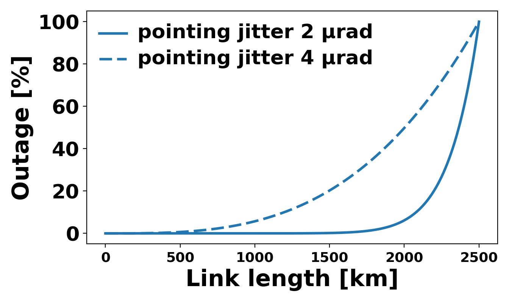

Link outage against range for the free-space optical ISL (2.5 W, 1,550 nm, 20 µrad divergence).
Outage is negligible over most of the range and then climbs steeply into the 2,500 km limit, so the
limit is a cliff rather than a cut-off: links near it exist but fail often. The exponent is
half-divergence² / (2 × pointing jitter²) = 12.5 at the stated values, and `BLT_simul/tools/verify_units.py`
checks the closed form against a Monte Carlo pointing fade. Pairs that newly come into range are
unusable until acquisition completes, and a relay's failure takes down everything behind it in the
same round.

`BLT_simul/model/blt_isl.py`

---

### 6.2 Where the 6 s cycle comes from

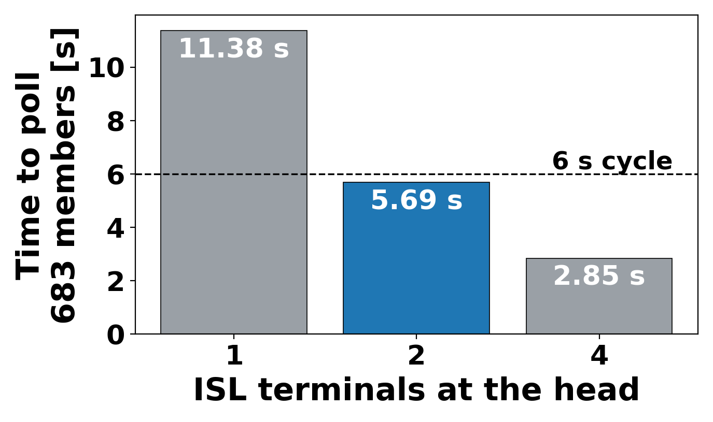

With twelve clusters, members reach their head over 1.97 hops on average (2,471 km, 16.7 ms round
trip), and a head has to poll about 683 of them. **With two ISL terminals that takes 5.69 s, which is
what fits inside a 6 s cycle**, one terminal needs 11.38 s and does not, four would need 2.85 s. The
cycle is a consequence of the orbit geometry and the link budget, not a free choice.

`BLT_simul/experiments/design/collection_time.py` → `BLT_simul/result/runs/collection_time.csv`

---

### 6.3 Communication efficiency

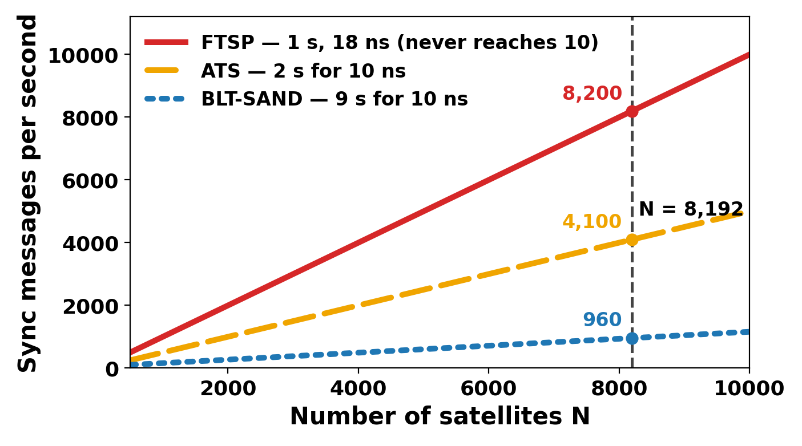

Messages per second against constellation size, each scheme at the longest cycle that still meets
10 ns, so the comparison is of inherent demand rather than of a tuning choice. At N = 8,192 that is
**960 msg/s for BLT-SAND against 4,100 for ATS**, a factor of 4.3.

FTSP has no qualifying cycle. A shorter flood does cut the drift it accrues between floods, but
only onto a floor it cannot go below, the one-way timestamp budget accumulated along the flood
path, which does not depend on the cycle and is about 18 ns. Measured 17.3 to 18.5 ns from 0.1 s
to 6 s. It is drawn at a 1 s cycle, which is already slower and so cheaper than the 0.45 s this
work runs FTSP at elsewhere, and is the longest measured cycle that still refreshes more often
than either scheme it is compared with. At that point it sends **8,200 msg/s** and still does not
reach the target. The axis is linear, as in the paper: a log axis bends a line that is
proportional to N and flattens a nineteen-fold gap into nothing.

---

### 6.4 Deployment flexibility

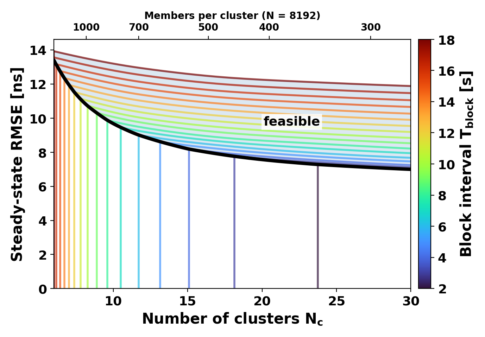

The same sweep with local = global = T_block and the link model on. Each curve begins at the smallest
cluster count its collection time allows, the vertical tick, and the thick black line joins those
limits, so the shaded area is where a configuration is feasible on collection time: a head finishes
polling its cluster inside the interval it is given. The accuracy a configuration reaches is the
curve itself, read off the y axis, and
its members can actually be polled within the interval. Shorter intervals are more accurate. The
curves fall to the right because a larger cluster means more relay hops and exchange noise grows with
√hops. That downward slope is a consequence of having the link model on: with ideal links the
curve would be flat to the right, and the relay cost is what bends it.

`BLT_simul/experiments/design/deployment_grid.py --local-equals-block`, `BLT_simul/experiments/design/collection_time.py`

---

## Regenerating all of it

```
python BLT_simul/figures/evaluation_panels.py
```

writes every panel above to `BLT_simul/result/evaluation/` as PNG and PDF.
[`REPRODUCING.md`](REPRODUCING.md) gives the driver behind each input. Each needs its CSV or
chain log first; a missing input skips that panel and is listed at the end of the run. The driver
that produces the input is named under each figure.
